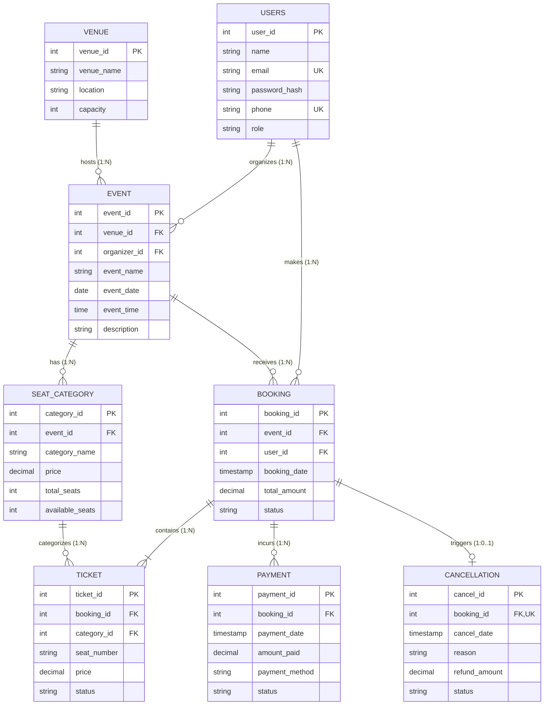

# BCSE302L – Database Systems: Review I Report
## EVENT AND TICKET BOOKING SYSTEM

**Team Members:**
- **Kevin T John** — `24BYB0163`
- **Govind B Nair** — `24BYB0101`
- **Shaarav S** — `24BYB0118`

---

## 1. Introduction
The **Event and Ticket Booking System** is an enterprise-grade relational database application engineered to manage venues, events, users, seat tiers, tickets, customer bookings, multi-attempt financial transactions, and cancellations. In contemporary event hosting and ticketing ecosystems, maintaining high transactional consistency, zero seat double-booking, and audit trails is paramount. This system models the entire lifecycle of an event from organizer publishing to customer ticket acquisition and refund processing.

---

## 2. Problem Statement
Manual or loosely coupled event ticketing workflows suffer from several critical shortcomings:
1. **Seat Double-Allocation**: Concurrent user checkouts can result in the same seat being issued to multiple customers.
2. **Venue Over-Allocation**: Events configured with ticket quotas that exceed the physical capacity of their assigned venue.
3. **Payment Reconciliation Gaps**: Inability to track failed, pending, and retried payment attempts tied to a single checkout session.
4. **Disorganized Cancellation & Refund Processing**: Lack of deterministic, time-decay refund calculations when patrons cancel tickets.
5. **Data Redundancy & Anomalies**: Unnormalized structures leading to update, insertion, and deletion anomalies.

A robust relational database with strong schema constraints, explicit foreign key cascades, and trigger-driven automation is required to resolve these issues.

---

## 3. Objectives
- Maintain distinct profiles for customers, event organizers, and system administrators.
- Manage physical venues with strict capacity limits.
- Manage diverse event schedules (concerts, technical symposiums, sports matches, conferences).
- Model multi-tier seat categories (e.g., VIP, Premium, General) with independent pricing and inventory quotas.
- Guarantee seat uniqueness within each category.
- Facilitate atomic multi-ticket bookings under a single transaction.
- Record multi-attempt payment histories (e.g., UPI, Cards, Net Banking) per booking.
- Provide structured cancellation handling with automated refund calculations.
- Lay the mathematical and structural groundwork for PL/pgSQL procedures, triggers, views, and complex analytical queries in Reviews II and III.

---

## 4. System Users & Role Permissions
The system categorizes access into three distinct user roles:

| Role | Permissions & Functional Scope |
| :--- | :--- |
| **Customer (`CUSTOMER`)** | Searches and browses active events; selects available seats across categories; initiates bookings; submits payments; views digital tickets; cancels bookings and requests refunds. |
| **Event Organizer (`ORGANIZER`)** | Manages venue bookings; creates and schedules events; defines seat categories, capacities, and tier pricing; monitors real-time sales and revenue. |
| **Database Administrator (`ADMIN`)** | Manages system-wide schemas, constraints, user roles, database auditing, query optimization, and transaction recovery. |

---

## 5. Functional Requirements
1. **User Identity Management**: Register and authenticate users with uniquely indexed email addresses and phone numbers.
2. **Venue Inventory**: Store venues with verifiable physical seat capacities and geographical locations.
3. **Event Scheduling**: Associate events with valid venues and registered organizers, verifying dates and times.
4. **Tiered Seat Category Management**: Configure categories per event with bounded seating capacities.
5. **Atomic Ticket Generation**: Issue individual tickets referencing specific bookings and seats upon successful checkout.
6. **Payment Lifecycle**: Support multiple payment attempts (handling failures and retries) linked to a parent booking.
7. **Cancellation & Refunds**: Support cancellation requests with timestamped tracking and deterministic refund computations.
8. **Real-time Inventory Tracking**: Maintain accurate `available_seats` counts and synchronized `total_amount` values across related tables.

---

## 6. Entity-Relationship (ER) Model

### 6.1 Entity Identification & Attribute Details

1. **`VENUE`**: Strong entity representing physical hosting locations.
   - `venue_id` (PK, Integer)
   - `venue_name` (Varchar, NOT NULL)
   - `location` (Varchar, NOT NULL)
   - `capacity` (Integer, CHECK > 0)

2. **`USERS`**: Strong entity representing actors interacting with the system.
   - `user_id` (PK, Integer)
   - `name` (Varchar, NOT NULL)
   - `email` (Varchar, UNIQUE, NOT NULL)
   - `password_hash` (Varchar, NOT NULL)
   - `phone` (Varchar, UNIQUE, NOT NULL)
   - `role` (Varchar, CHECK IN ('CUSTOMER', 'ORGANIZER', 'ADMIN'))

3. **`EVENT`**: Strong entity representing organized gatherings.
   - `event_id` (PK, Integer)
   - `venue_id` (FK $\rightarrow$ VENUE.venue_id)
   - `organizer_id` (FK $\rightarrow$ USERS.user_id)
   - `event_name` (Varchar, NOT NULL)
   - `event_date` (Date, NOT NULL)
   - `event_time` (Time, NOT NULL)
   - `description` (Text)

4. **`SEAT_CATEGORY`**: Entity defining ticket tiers for events.
   - `category_id` (PK, Integer)
   - `event_id` (FK $\rightarrow$ EVENT.event_id)
   - `category_name` (Varchar, NOT NULL)
   - `price` (Numeric, CHECK >= 0)
   - `total_seats` (Integer, CHECK > 0)
   - `available_seats` (Integer, CHECK >= 0)

5. **`BOOKING`**: Entity recording customer reservations.
   - `booking_id` (PK, Integer)
   - `event_id` (FK $\rightarrow$ EVENT.event_id)
   - `user_id` (FK $\rightarrow$ USERS.user_id)
   - `booking_date` (Timestamp, NOT NULL)
   - `total_amount` (Numeric, CHECK >= 0)
   - `status` (Varchar, CHECK IN ('PENDING', 'CONFIRMED', 'CANCELLED'))

6. **`TICKET`**: Entity representing individual admission passes.
   - `ticket_id` (PK, Integer)
   - `booking_id` (FK $\rightarrow$ BOOKING.booking_id)
   - `category_id` (FK $\rightarrow$ SEAT_CATEGORY.category_id)
   - `seat_number` (Varchar, NOT NULL)
   - `price` (Numeric, CHECK >= 0)
   - `status` (Varchar, CHECK IN ('VALID', 'USED', 'CANCELLED'))

7. **`PAYMENT`**: Entity capturing monetary transactions.
   - `payment_id` (PK, Integer)
   - `booking_id` (FK $\rightarrow$ BOOKING.booking_id)
   - `payment_date` (Timestamp, NOT NULL)
   - `amount_paid` (Numeric, CHECK >= 0)
   - `payment_method` (Varchar, CHECK IN ('CARD', 'UPI', 'NET_BANKING', 'WALLET'))
   - `status` (Varchar, CHECK IN ('SUCCESS', 'FAILED', 'PENDING', 'REFUNDED'))

8. **`CANCELLATION`**: Entity documenting booking revocation.
   - `cancel_id` (PK, Integer)
   - `booking_id` (FK $\rightarrow$ BOOKING.booking_id, UNIQUE)
   - `cancel_date` (Timestamp, NOT NULL)
   - `reason` (Text)
   - `refund_amount` (Numeric, CHECK >= 0)
   - `status` (Varchar, CHECK IN ('REQUESTED', 'APPROVED', 'PROCESSED', 'REJECTED'))

---

### 6.2 ER Diagram (Crow's Foot Notation)

---

### 6.3 Relationship Cardinalities & Structural Business Rules

1. **`VENUE — EVENT` ($1 : N$)**: One venue can host zero, one, or many events over time; each event is held at exactly one venue.
2. **`USERS — EVENT` ($1 : N$)**: An organizer user can organize multiple events; an event has exactly one designated primary organizer.
3. **`EVENT — SEAT_CATEGORY` ($1 : N$)**: An event defines one or more seat categories (e.g., Balcony, Orchestra); each category belongs to one event.
4. **`EVENT — BOOKING` ($1 : N$)**: An event can accumulate multiple bookings; each booking references one event.
5. **`USERS — BOOKING` ($1 : N$)**: A customer user can make multiple bookings; each booking belongs to one customer.
6. **`SEAT_CATEGORY — TICKET` ($1 : N$)**: A category classifies multiple tickets; each ticket belongs to one seat category.
7. **`BOOKING — TICKET` ($1 : N$)**: A booking comprises one or more tickets; each ticket is part of exactly one booking.
8. **`BOOKING — PAYMENT` ($1 : N$)**: A booking can have multiple payment records (enabling tracking of failed attempts followed by a successful attempt).
9. **`BOOKING — CANCELLATION` ($1 : 0..1$)**: A booking may have at most one cancellation entry (guaranteed via `UNIQUE(booking_id)`).

---

## 7. Relational Schema & Integrity Constraints

### 7.1 Schema Definitions
- $\text{VENUE}(\underline{\text{venue\_id}}, \text{venue\_name}, \text{location}, \text{capacity})$
- $\text{USERS}(\underline{\text{user\_id}}, \text{name}, \text{email}^{\text{UK}}, \text{password\_hash}, \text{phone}^{\text{UK}}, \text{role})$
- $\text{EVENT}(\underline{\text{event\_id}}, \text{venue\_id}^{\text{FK}}, \text{organizer\_id}^{\text{FK}}, \text{event\_name}, \text{event\_date}, \text{event\_time}, \text{description})$
- $\text{SEAT\_CATEGORY}(\underline{\text{category\_id}}, \text{event\_id}^{\text{FK}}, \text{category\_name}, \text{price}, \text{total\_seats}, \text{available\_seats})$
- $\text{BOOKING}(\underline{\text{booking\_id}}, \text{event\_id}^{\text{FK}}, \text{user\_id}^{\text{FK}}, \text{booking\_date}, \text{total\_amount}, \text{status})$
- $\text{TICKET}(\underline{\text{ticket\_id}}, \text{booking\_id}^{\text{FK}}, \text{category\_id}^{\text{FK}}, \text{seat\_number}, \text{price}, \text{status})$
  - $\text{Candidate Key / Unique Constraint}: (\text{category\_id}, \text{seat\_number})$
- $\text{PAYMENT}(\underline{\text{payment\_id}}, \text{booking\_id}^{\text{FK}}, \text{payment\_date}, \text{amount\_paid}, \text{payment\_method}, \text{status})$
- $\text{CANCELLATION}(\underline{\text{cancel\_id}}, \text{booking\_id}^{\text{FK, UK}}, \text{cancel\_date}, \text{reason}, \text{refund\_amount}, \text{status})$

---

## 8. Database Normalization Analysis

### 8.1 First Normal Form (1NF)
- **Criterion**: All attribute values are atomic; there are no repeating groups or multivalued attributes.
- **Verification**:
  - `phone` is a single atomic string.
  - Rather than storing multiple seat numbers in a comma-separated column in `BOOKING`, individual seat allocations are factored into the `TICKET` relation.
  - Multiple payment attempts are decomposed into separate rows in `PAYMENT`.
  - **Verdict**: Schema is strictly in **1NF**.

### 8.2 Second Normal Form (2NF)
- **Criterion**: The relation is in 1NF, and no non-prime attribute is partially dependent on any candidate key (no partial functional dependency).
- **Verification**:
  - In all tables (`VENUE`, `USERS`, `EVENT`, `SEAT_CATEGORY`, `BOOKING`, `PAYMENT`, `CANCELLATION`), the primary key is a single surrogate attribute (`venue_id`, `user_id`, etc.), making partial dependency structurally impossible.
  - In `TICKET`, the candidate key is `ticket_id` (single attribute) as well as composite alternate key `(category_id, seat_number)`. All attributes (`price`, `status`, `booking_id`) depend fully on both `ticket_id` and the specific seat instance.
  - **Verdict**: Schema is strictly in **2NF**.

### 8.3 Third Normal Form (3NF)
- **Criterion**: The relation is in 2NF, and no non-prime attribute is transitively dependent on the primary key (no $X \rightarrow Y$ and $Y \rightarrow Z$ where $Z$ is non-prime).
- **Verification**:
  - `EVENT`: `venue_name` and `organizer_name` are not duplicated here; they reference `venue_id` and `user_id`.
  - `TICKET`: `event_id` is not duplicated in `TICKET` because it is obtainable through `SEAT_CATEGORY(category_id)`.
  - `CANCELLATION`: Customer information is not redundantly stored; it is retrieved via `booking_id`.
  - `BOOKING.total_amount` and `SEAT_CATEGORY.available_seats` are controlled derived fields kept for performance and kept synchronized through trigger automation.
  - **Verdict**: Schema is strictly in **3NF**.

### 8.4 Boyce-Codd Normal Form (BCNF)
- **Criterion**: For every non-trivial functional dependency $X \rightarrow Y$, $X$ must be a superkey.
- **Verification**:
  - In `USERS`: $\text{email} \rightarrow \text{user\_id}, \dots$ (email is a candidate key).
  - In `TICKET`: $(\text{category\_id}, \text{seat\_number}) \rightarrow \text{ticket\_id}, \dots$ (this composite pair is a candidate key).
  - Every determinant in every relation is a superkey.
  - **Verdict**: Schema satisfies **BCNF**.

---

## 9. Conclusion & Transition to Review II
The database design established in Review I provides a solid, 3NF/BCNF compliant relational foundation. 

In **Review II**, this design translates directly into:
1. Executable PostgreSQL DDL with strict constraint validation.
2. Realistic sample data seeding across all 8 tables.
3. Execution of complex analytical SQL queries (Joins, Aggregations, Grouping, Having, Subqueries, and Window Functions).
